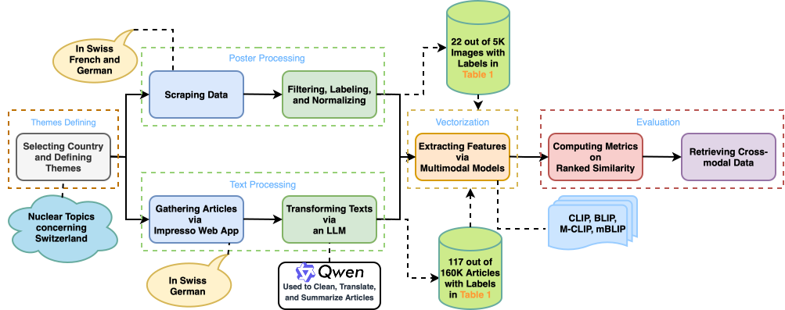

# Match Me if You Can: Aligning Historical Posters and Newspaper Articles via Multimodal Deep Learning

[Read the paper](https://doi.org/10.1093/llc/fqag088) · *Digital Scholarship in the Humanities* (2026)

Research code for linking historical posters from LAKA and newspaper articles from Impresso using pretrained vision-language models. The case study explores four themes in the European nuclear power debate: **nuclear accidents, nuclear waste, protest, and environmentalism**. The workflow compares original text with cleaned text, English translations, and English summaries, then ranks candidates by cosine similarity between their representations.

**Start with [`scripts/intra_modal_retrieval.py`](scripts/intra_modal_retrieval.py)**, the main experiment entry point for text retrieval. It compares theme queries against newspaper titles or articles using bag-of-words, TF-IDF, CLIP, or BLIP. Supporting scripts cover poster analysis, cross-modal retrieval, and text preprocessing.

> **Reproduction status:** This checkout contains research scripts with missing data, inconsistent interfaces, and machine-specific paths. Follow the setup and data instructions below, and review [Known execution issues](#known-execution-issues) before running experiments. Installing dependencies alone does not make the main script executable.

## Experiment pipeline



## Repository guide

| Path | Purpose |
| --- | --- |
| [`scripts/intra_modal_retrieval.py`](scripts/intra_modal_retrieval.py) | Main entry point: theme-to-text retrieval and average precision/recall. |
| [`scripts/config.py`](scripts/config.py) | Themes, query prompts, preprocessing roles, model identifiers, data paths, and `top_k`. |
| [`scripts/text_manipulation.py`](scripts/text_manipulation.py) | Load theme-specific articles/titles, preprocess text, lemmatize, and plot corpus statistics. |
| [`scripts/clean_text_dataset.py`](scripts/clean_text_dataset.py) | Clean, translate, or summarize articles with an LLM through vLLM; cache processed datasets. |
| [`scripts/feature_extractor.py`](scripts/feature_extractor.py) | Extract image/text representations with CLIP, BLIP, M-CLIP, and mBLIP. |
| [`scripts/cross_modal_retrieval.py`](scripts/cross_modal_retrieval.py) | Poster–article and poster–caption retrieval; supporting experiments in the paper. |
| [`scripts/poster_manipulation.py`](scripts/poster_manipulation.py) | Load annotated posters, extract features, plot similarities, and compute retrieval metrics. |
| [`scripts/plot_examples.py`](scripts/plot_examples.py) | Plot retrieval examples for qualitative inspection. |
| [`data/`](data/) | Included poster tensors, metadata, annotations, article sample, and cached outputs. |

## Setup

### 1. Clone and create an environment

The supplied cluster script uses Python 3.11.3. Python 3.11 is a starting point; this repository does not include a pinned dependency file or a fully specified reproduction environment.

```bash
git clone https://github.com/StevenXuf/MatchMeIfYouCan.git
cd MatchMeIfYouCan
python3.11 -m venv .venv
source .venv/bin/activate
python -m pip install --upgrade pip
```

For the existing model execution paths, use a Linux machine with NVIDIA GPUs. The intra-modal feature extractors default to CUDA device `0`, and text preprocessing uses vLLM. CPU-only use requires adapting those paths and imports. Model weights are downloaded on first use, so allow network access and sufficient disk space and GPU memory.

### 2. Install dependencies

Install vLLM with a compatible PyTorch/CUDA stack using its [GPU installation instructions](https://docs.vllm.ai/en/latest/getting_started/installation/gpu/). Then install the other packages imported by the retrieval workflow:

```bash
python -m pip install torchvision torchmetrics scikit-learn numpy pandas \
  transformers datasets multilingual-clip spacy nltk matplotlib wordcloud \
  tqdm termcolor fire Pillow beautifulsoup4 requests openpyxl
python -m spacy download de_core_news_sm
python -m nltk.downloader stopwords punkt punkt_tab
python -m pip check
```

Keep `torch` and `torchvision` versions compatible. These are dependency names inferred from the scripts, not a tested version lock. `text_manipulation.py` imports vLLM indirectly and downloads NLTK resources at import time; those dependencies are needed even when text transformation is disabled. Its corpus plots also invoke German lemmatization, so the spaCy model is needed when loading data through `get_contents`.

### 3. Provide the BLIP implementation

`feature_extractor.py` imports `models.blip_itm` from an external checkout at `/home/fxu/Alignment/BLIP_Official`. That checkout is **not included**. Make a compatible BLIP implementation available on `PYTHONPATH`, for example:

```bash
# Replace this example path with your compatible BLIP checkout.
export PYTHONPATH="/absolute/path/to/BLIP_Official${PYTHONPATH:+:$PYTHONPATH}"
```

The repository expects `blip_itm(...)(image, caption, match_head='itc')` to return **two feature tensors**. The [upstream Salesforce BLIP implementation](https://github.com/salesforce/BLIP/blob/main/models/blip_itm.py) returns a similarity matrix instead, so a plain upstream clone does not satisfy this interface. Use the compatible implementation from the experiment environment or adapt the interface before running BLIP. Its configuration files must also be accessible from the working directory.

BLIP is imported unconditionally, including for bag-of-words, TF-IDF, and CLIP runs. Those runs therefore also need the import to resolve, or a local change to defer it.

## Data preparation

The paper evaluates curated subsets of **22 labeled posters and 117 labeled articles**, and larger collections of **5,054 posters and 160,828 articles**. The files in this checkout do not supply all of those experiment inputs.

| Included file(s) | Contents / role |
| --- | --- |
| `data/swiss_poster_links.csv`, `data/swiss_poster_data.pt` | Swiss poster links and stored image/text data used by the configured poster loader. |
| `data/poster_anno.xlsx` | Poster annotations used to select the thematic subset. |
| `data/posters_with_texts.pt`, `data/swiss_poster_data_n45.pt` | Additional stored poster data. |
| `data/impresso_nuclear.csv` | A semicolon-separated sample with 66 article rows; not the full or theme-partitioned corpus. |
| `data/poster_article_pairs.csv` | Poster/article metadata and contextual information. |
| `data/LAKA_caps/processed_batch_translate/` | A cached Hugging Face dataset of translated poster captions. |
| `data/index_clip.json`, `data/index_blip.json`, `data/index_mclip.json` | Saved indices used by retrieval visualization. |

`get_contents` expects eight **semicolon-separated CSV files** under `data/impresso/`, which is absent from the checkout:

```text
data/impresso/
├── nuclear_accidents_related.csv
├── nuclear_accidents_unrelated.csv
├── nuclear_waste_related.csv
├── nuclear_waste_unrelated.csv
├── protest_related.csv
├── protest_unrelated.csv
├── environmentalism_related.csv
└── environmentalism_unrelated.csv
```

Each CSV must have `title` and `content` columns. The current loader also drops `title.1` and `content.1`, so it expects those duplicate export columns to exist. Obtain the theme-specific exports and annotations used for the paper, or prepare equivalent exports with the same schema and labeling rules. Renaming the included sample cannot recover the missing corpus or labels.

The full-corpus preprocessing entry point expects `data/impresso/impresso160k.csv`. Full poster retrieval expects country folders containing matching `.png` and `.txt` files at the default path `/data/data_fxu/deduped` in `read_posters.py`; that external directory is also absent. Supply the data and pass or adapt paths for your environment.

## Running the main experiments

Run from **`scripts/`**, because paths such as `../data/` and `../figures/` are relative to the current working directory. Create the output directories first:

```bash
# From the repository root, with the environment activated.
mkdir -p figures logs
cd scripts
```

### Select an experiment

`intra_modal_retrieval.py` has no command-line argument parser. Its `__main__` block defines the following defaults:

```python
method = 'blip'
query = 'queries_en'
corpus = 'articles'
text_transform = True
lemmatization = False
compute_results(method, query, corpus, text_transform, lemmatization)
```

For your experiment, set these values in the script's `__main__` block and set `top_k` in `config.py`. Passing flags such as `--method` to the main script does not configure a run.

| Setting | Values | Meaning |
| --- | --- | --- |
| `method` | `bow`, `tfidf`, `clip`, `blip` | Count/TF-IDF vectors or pretrained text features, ranked by cosine similarity. |
| `query` | `queries_de`, `queries_en`, `prompts_de`, `prompts_en` | German/English themes or sentence prompts. See the config-name mismatch below. |
| `corpus` | `titles`, `articles` | Retrieve newspaper titles or full articles. |
| `text_transform` | `False`, `True` | Intended to enable LLM transformation of the corpus; the current transformation call needs reconciliation. |
| `lemmatization` | `False`, `True` | Apply German spaCy lemmatization to the retrieval corpus. |
| `config.top_k` | Positive integer; default `10` | Number of retrieved candidates per query; keep it within the candidate count. |

The feature module provides M-CLIP and mBLIP, but the intra-modal metric function only implements CLIP and BLIP. Do not select `mclip` or `mblip` for this entry point without adding the missing dispatch.

For a first baseline, use `bow` or `tfidf` with German themes and untransformed articles **after resolving the execution issues below**. For comparisons with English queries, prepare the corresponding English translations or summaries; choosing `queries_en` alone does not translate the corpus.

Once the dependencies, input data, and interfaces are ready, launch the selected main experiment and retain its output:

```bash
python intra_modal_retrieval.py > ../logs/intra_modal_retrieval.log 2>&1
```

The script prints ranked articles with similarity scores, per-query precision/recall, and average precision/recall as percentages. It does not save a results table. Corpus loading writes diagnostic PDFs to `figures/`.

### Text preprocessing and caches

The paper uses Qwen2.5-7B-Instruct to clean OCR text, translate it to English, or summarize it in English within 76 tokens. The matching definitions in `config.py` are `qwen`, `system_role_editor`, `system_role_translator`, and `system_role_summarizer`.

The checked-in `qwen` identifier is `Qwen/Qwen2.5-7B-Instruct-1M`; record the exact model variant used in your run when comparing it with the paper.

`clean_text` stores Hugging Face datasets in `processed_batch_clean`, `processed_batch_translate`, or `processed_batch_sum` under the chosen path. The output has `metadata` and `clean_data` columns. Subset processing uses `data/impresso/subset/`; full-corpus processing uses `data/impresso/fullset/`.

Existing caches are reused by row count, without checking input contents, model, or prompt. Use a separate output path or remove the relevant cache when changing those inputs. Record the model, role, seed, data ordering, package versions, and retrieval settings when comparing runs.

### Supporting cross-modal experiments

`cross_modal_retrieval.py` contains `compute_poster_article_metrics(system_role, model_name, task, llm=config.qwen, is_meta=False)` for poster–article retrieval. It accepts `img2txt` or `txt2img`, computes relevance from shared themes, and reports P@K, R@K, MRR@K, and mAP@K for K = 1, 5, and 10.

Its current `__main__` block instead runs **poster–caption retrieval with translated captions**, using positional model and `-t/--task` arguments. The Fire entry point for poster–article retrieval is commented out. `automaticeval.sh` therefore runs poster–caption comparisons; it does not launch all poster–article experiments. Call the appropriate function after preparing its inputs and dependencies.

<a name="known-execution-issues"></a>
<details>
<summary>Known execution issues</summary>

These issues are present in the checked-in code and need local reconciliation for reproduction:

| Issue / symptom | What to check |
| --- | --- |
| Cannot import `manipulate_texts` | The main script imports and calls it, but `text_manipulation.py` does not define it. The available preprocessing function is `clean_text` in `clean_text_dataset.py`, with a different signature and return type. |
| `get_contents` missing `role` and `model` arguments | The main script calls `get_contents(config.english_topics)`; the provided signature is `get_contents(topics, role, model, is_meta=False, path='../data/impresso')`. Use the appropriate preprocessing role/model, or raw text with `is_meta=True`, when reconciling the call. |
| Missing query or model config attributes | The main script uses `german_queries`, `english_queries`, `llama_3_1_8b_instruct`, and `system_role_en_summarizer`. The config provides `german_topics`, `english_topics`, `llama`, and `system_role_summarizer` instead. For the paper's Qwen preprocessing, use `config.qwen`. |
| Missing theme CSVs or full data directories | Supply the inputs described in [Data preparation](#data-preparation); the included article sample is not a replacement for the paper's labeled corpus. |
| Cannot import `models.blip_itm`, or incompatible BLIP output | Provide the compatible external BLIP implementation and its configuration files as described in setup. |
| CUDA device or memory errors | Check the device defaults: intra-modal extractors use GPU `0`, poster feature extraction defaults to GPU `2`, and full preprocessing uses all visible GPUs. Use `CUDA_VISIBLE_DEVICES` and consistent device arguments. vLLM requests a 45,000-token context, which also affects memory use. |

**Metric interpretation:** The intra-modal metric loops use `range(1, N)[start:end]` for relevant article indices, which omits the final candidate. The loader also returns related and unrelated groups together, while those loops treat each corpus group as the relevant set for the corresponding query. Review index boundaries and label alignment before using those scores as evidence of paper reproduction. The cross-modal metric helper uses explicit relevance targets and additionally reports MRR and mAP.

The supplied Slurm job script contains institution-specific accounts, paths, and modules. Treat it as an environment example; adapt it before submitting jobs.

</details>

## Citation

If you find this work useful, please cite our paper:

```bibtex
@article{xu2026aligning,
    author  = {Xu, Fan and Düring, Marten and Leiva, Luis A},
    title   = {Match Me if You Can: Aligning Historical Posters and Newspaper articles via Multimodal Deep Learning},
    journal = {Digital Scholarship in the Humanities},
    pages   = {fqag088},
    year    = {2026},
    month   = {06},
    issn    = {2055-7671},
    doi     = {10.1093/llc/fqag088},
    url     = {https://doi.org/10.1093/llc/fqag088},
    eprint  = {https://academic.oup.com/dsh/advance-article-pdf/doi/10.1093/llc/fqag088/68561366/fqag088.pdf},
}
```

## License

The code is released under the [MIT License](LICENSE). Consult the original LAKA and Impresso sources for conditions governing reuse of their data.
